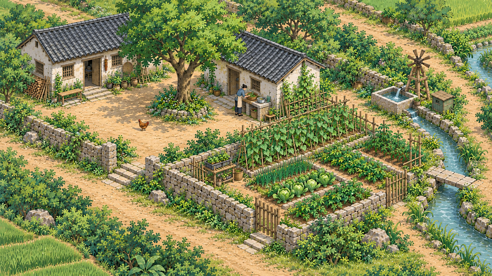

# 图片规格与美术、动作制作

更新：2026-10-13。作者已确认本期图片制作、重叠和发布路线。
本文件是规格唯一依据；本轮只同步文档，不生图、裁图、重导资源或修改运行代码。
空间见 [二维规划](rural-scenes.md)，实施状态见 [当前状态](design.md)，运行成本见 [性能预估](performance.md)。

## 唯一画风基准

参考原图 1672×941，文件与像素不变。来源见 [参考记录](../assets/art-direction/README.md)。
新背景与主体沿用笔触、色彩、造型、斜俯视、比例与光照，重新设计构图，不复用之前草图。
参考含居民、鸡与风轮，只表达风格，不作为可重复叠加主体的干净背景。
当前网页与对照长卷用于检查问题，不能自动作为新构图输入。

## 已确认的本期固定规格

| 项目 | 固定规格 |
| --- | --- |
| 单张背景原图的工作规格 | 2160×720 像素，3:1，统一局部物件像素密度 |
| 纵向原图数量 | 上、中、下三张，不再将两图或整高单图列为本期备选路线 |
| 上下相邻重叠 | 144 像素，即单张高度的 20% |
| 纵向放置 | y = 0、576、1152；有效总高度 1872 像素 |
| 左右相邻重叠 | 216 像素，即单张宽度的 10%；横向步长 1944 像素 |
| 横向展开 | 标准图块按内容增加；不同场所占不同数量，不用不同原图尺寸表达不同宽度 |
| 横向有效宽度 | N 列为 2160 + (N − 1) × 1944；最右自然边界可按内容裁去未用余量 |
| 发布背景块 | 有效内容最大 1024×1024 像素，不足尺寸的边缘块按实际范围裁切 |
| 发布采样边缘 | 每边 2 像素，复制最终背景对应邻域；满块文件最多 1028×1028 |
| 发布格式 | WebP；精度与编码质量按边缘和细节检查，质量数值不作为已确认硬约束 |
| 发布坐标 | 共同世界坐标，背景块的有效内容不重复；采样边缘不扩大世界尺寸 |

2160×720 是工作规格，不承诺生成工具每次精确返回此尺寸。
保留原始生成文件和实际尺寸记录；微小额外边缘通过裁边归一，不拉伸。
返回尺寸不足、物件像素密度不符或裁边会切坏核心对象时返工，
不能放大不足尺寸的稿件凑规格。唯一参考不参与这种归一处理。

三张原图是生产分工，不能画成三排重复场景；
区域和建筑可跨制作范围，实际接续边界在重叠带中避让完整轮廓。
需要局部补画时仍按共同坐标修接，不改变本期三图和发布路线。

## 重叠的用途与成本

纵向总输入高度 2160，重叠高度合计 288，有效高度 1872。
因此纵向重复占总输入像素约 13.3%，不是整个输入都重复 20%。
计入横向 10% 重叠后，长卷内部总重复比例随列数增加趋近 22%，属于制作源稿成本。

共享区域用于约束视角、比例、道路水系、地形与完整对象。
重叠本身不能保证生成图一致；先修接再发布，不用植被墙、模糊或动态透明度隐藏错误。
原始 PNG 和重叠区留在源工程，浏览器不下载工作 PNG。

## 背景制作与发布流程

1. 将已确认空间方案落到共同坐标和原图分工，登记主路、渠岸、坡脚、
   建筑轮廓与邻接约束；完整场所不受图块网格限制。
2. imagegen 辅助背景原画，固定唯一风格、视角、光向、比例和共享位置。
   原图归一到工作规格，新土地通过新增标准图块承载。
3. 先核对完整拼合、默认与最大视野，修正重复用途、通路断裂、季相和接续。
   每个位置确定唯一背景像素，静态接续边界在制作阶段定稿。
4. 导出工具逐块合成并裁切已接好的背景，不要求生成一张全长巨型 PNG。
   将工作原图的重叠像素去重，输出有效内容不重叠的发布块和采样边缘。
5. 验证发布块共同坐标、接边、内容哈希、字节数和源图对应关系，
   局部修改只重新导出受影响背景块。
6. 页面加载发布块，不再依靠源稿之间的复杂实时遮罩或叠化修接。
   源原图数量与网页图片数量分别管理。

现有 Sharp 支持合成与裁切，这是实现依据，新的导出链路尚未编写和验证：
[合成](https://sharp.pixelplumbing.com/api-composite/)、
[裁切](https://sharp.pixelplumbing.com/api-resize/#extract)。

## 独立主体与动作

正式背景不含需要活动的居民、动物或机械活动部分。
大多数静态器物留在背景，仅拆出活动主体与必要遮挡。
主体先静止放回场景，核对尺度、笔触、光照、接地与前后关系，再做动作。

固定角色母稿和部件，不逐帧重新生成整个人物，不把独立姿态自动当连续动画。
Blender 可用于二维部件、固定相机与关键帧，保留源工程、转轴、曲线和说明；
Blender 到网页的导出约定仍待样片验证，不能宣称一键可用。

| 内容 | 待样片验证的交付方式 |
| --- | --- |
| 简单部件活动 | 复用贴图与有限关键帧 |
| 复杂接触、手脚与形变 | 补姿态或短透明序列帧 |
| 有用途的水车、风轮 | 轴心与部件连续运动 |
| 水纹、烟气与轻微变化 | 局部纹理或简单连续效果 |

背景块的 1024 规格不套用到动作帧；主体按实际观看尺寸裁切透明空白。
记录共同锚点、帧时长、循环和必要步幅，停顿复用静止姿态。
居民检查重心、接触、启停和停顿；鸡检查步幅、落脚、位移与停止衔接。
整图叠化、加帧和提高刷新率不能补救错误原稿或滑步。

先验证一个居民、一只鸡及其场景预览，正常速度整体观感优先，
辅以慢速和最大尺度定位问题。观感与设备成本通过后扩展。
首期固定初夏上午且无声，不制作冬季、夜晚或切换系统。

## 固定方案与实施调优的边界

原图规格、纵向三图、重叠、去重发布和背景块尺寸为作者已确认的本期基线。
不再自行切换两图、整高单图、不同原图宽度或把工作重叠完整搬到网页。
物件清单、编码质量、请求调度、缓存预算与动作采样属于实施细化，
按质量和实测优化，不改变上述路线。
规格确认不等于图片接续、导出、动画或性能已通过验收。
